# Práctica NGINX: instalación, configuración y reverse proxy

## Requisitos

- Ubuntu Server (probado en 24.04)
- Usuario con permisos de administrador (`sudo`)
- Apache escuchando en el puerto 80 (NGINX irá en el 8080)
- Cliente Windows con navegador para las comprobaciones

---

## 1. Investigación teórica

### ¿Qué es NGINX?

**NGINX** (pronunciado "engine-x") es un servidor web de alto rendimiento, proxy inverso, balanceador de carga y caché HTTP. Fue creado por **Igor Sysoev** y publicado en 2004. Es software libre y de código abierto (licencia BSD de 2 cláusulas).

Nació para resolver el problema **C10K** (manejar 10.000 conexiones concurrentes). Usa una **arquitectura asíncrona orientada a eventos**, por lo que gestiona miles de conexiones con muy poca memoria.

### Diferencias entre Apache y NGINX

| Aspecto | Apache | NGINX |
|---|---|---|
| **Arquitectura** | Procesos/hilos (MPM: prefork, worker, event) | Orientada a eventos, asíncrona |
| **Rendimiento / memoria** | Más consumo bajo alta concurrencia | Muy bajo consumo, excelente con contenido estático |
| **Configuración** | Central + `.htaccess` por directorio | Solo configuración central (no soporta `.htaccess`) |
| **Contenido dinámico** | Módulos en proceso (ej. `mod_php`) | Proxy hacia PHP-FPM u otros backends |
| **Uso típico** | Hosting compartido, aplicaciones legadas | Reverse proxy, balanceador, sitios de alto tráfico |
| **Año de aparición** | 1995 | 2004 |

### ¿Qué es un Reverse Proxy?

Un **reverse proxy** es un servidor situado delante de uno o varios servidores de aplicaciones (backends). Los clientes se conectan al proxy, que reenvía las peticiones a los servidores internos y devuelve la respuesta.

**Ventajas:**

- Oculta la estructura interna de la red
- Balanceo de carga
- Terminación SSL/TLS
- Caché
- Mejora de seguridad (rate limiting, WAF, etc.)

**Ejemplo básico con NGINX:**

```nginx
server {
    listen 80;
    server_name ejemplo.com;

    location / {
        proxy_pass http://127.0.0.1:3000;          # Backend
        proxy_set_header Host              $host;
        proxy_set_header X-Real-IP         $remote_addr;
        proxy_set_header X-Forwarded-For   $proxy_add_x_forwarded_for;
        proxy_set_header X-Forwarded-Proto $scheme;
    }
}
```

La directiva clave es `proxy_pass`. Las cabeceras `X-Forwarded-*` permiten al backend conocer la IP real del cliente y el protocolo original.

---

## 2. Instalación de NGINX

### 2.1 Actualizar el sistema e instalar NGINX

```bash
sudo apt update
sudo apt install nginx -y
```


### 2.2 Comprobar la versión instalada

```bash
nginx -v
```

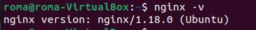

### 2.3 Comprobar los puertos en uso

```bash
sudo ss -tlnp | grep -E ':80|:8080'
```

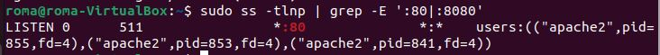


---

## 3. Configurar NGINX en el puerto 8080

### 3.1 Editar el sitio por defecto

```bash
sudo nano /etc/nginx/sites-available/default
```

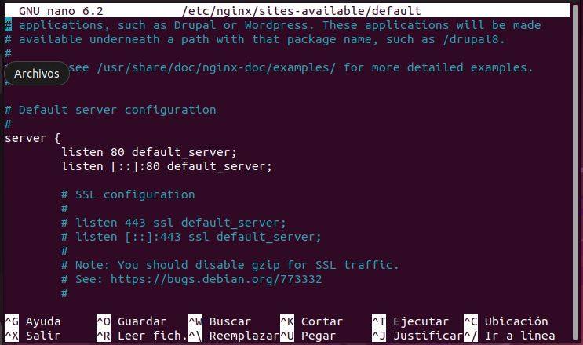

Buscar estas líneas:

```nginx
listen 80 default_server;
listen [::]:80 default_server;
```

Y cambiarlas por:

```nginx
listen 8080 default_server;
listen [::]:8080 default_server;
```

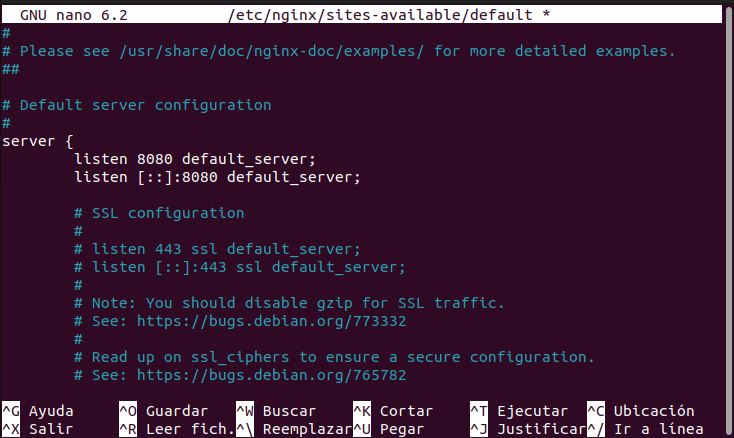

Para aclarar -> A partir de aquí utilizaré la terminal de windows para poder utilizar nano correctamente, ya que en la terminal de ubuntu por alguna razón el ^O no funciona.

### 3.2 Comprobar que la configuración es correcta

```bash
sudo nginx -t
```

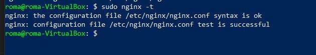

### 3.3 Reiniciar NGINX

```bash
sudo systemctl restart nginx
```

### 3.4 Verificar el estado del servicio

```bash
sudo systemctl status nginx
```

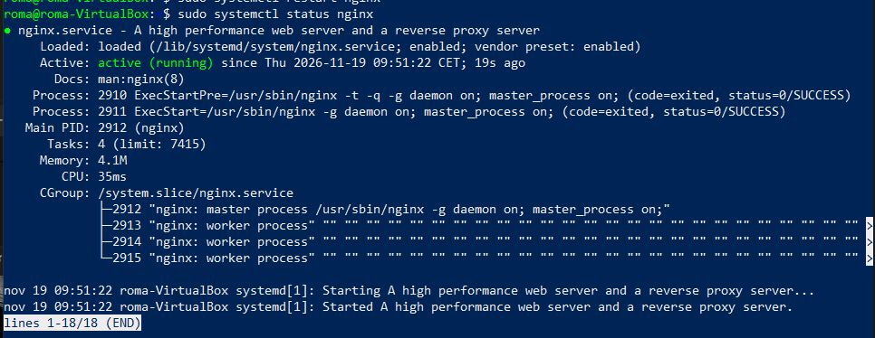

### 3.5 Comprobar de nuevo los puertos

```bash
sudo ss -tlnp | grep -E ':80|:8080'
```

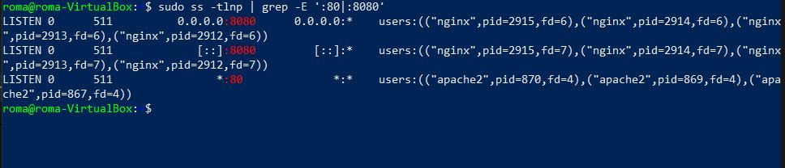

---

## 4. Página de bienvenida personalizada

### 4.1 Crear el directorio del sitio

```bash
sudo mkdir -p /var/www/nginx-test
```

### 4.2 Crear el archivo `index.html`

```bash
sudo nano /var/www/nginx-test/index.html
```

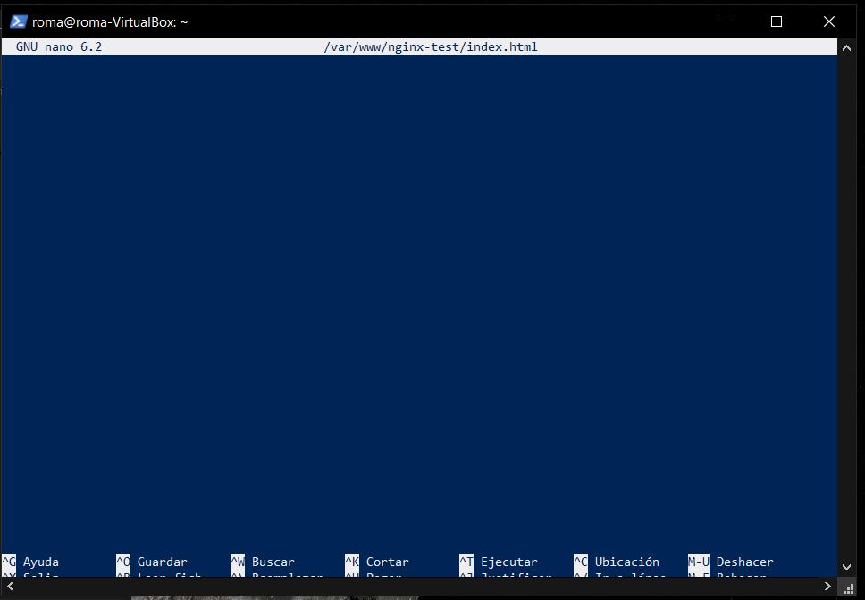

Pegar el siguiente contenido:

```html
<!DOCTYPE html>
<html lang="es">
<head>
    <meta charset="UTF-8">
    <title>Bienvenida a NGINX</title>
    <style>
        body { font-family: Arial, sans-serif; max-width: 900px; margin: 40px auto; padding: 20px; background: #f4f4f4; }
        .container { background: white; padding: 40px; border-radius: 10px; box-shadow: 0 4px 15px rgba(0,0,0,0.1); }
        h1 { color: #009639; }
        h2 { color: #007a2f; }
    </style>
</head>
<body>
    <div class="container">
        <h1>¡Bienvenido a NGINX!</h1>
        <p>Esta página está siendo servida por <strong>NGINX</strong> en el puerto <strong>8080</strong>.</p>

        <h2>¿Qué es NGINX?</h2>
        <p>NGINX es un servidor web de alto rendimiento, proxy inverso y balanceador de carga creado por Igor Sysoev en 2004. Utiliza una arquitectura orientada a eventos que le permite manejar miles de conexiones concurrentes con bajo consumo de memoria.</p>

        <h2>Diferencias con Apache</h2>
        <ul>
            <li>NGINX usa arquitectura de eventos: más eficiente bajo alta carga</li>
            <li>Apache usa procesos/hilos y soporta .htaccess</li>
            <li>NGINX destaca como reverse proxy y balanceador de carga</li>
        </ul>

        <h2>Reverse Proxy</h2>
        <p>Un reverse proxy se sitúa delante de los servidores de aplicaciones, reenviando las peticiones de los clientes y devolviendo las respuestas. Con NGINX se configura principalmente con la directiva <code>proxy_pass</code>.</p>
    </div>
</body>
</html>
```

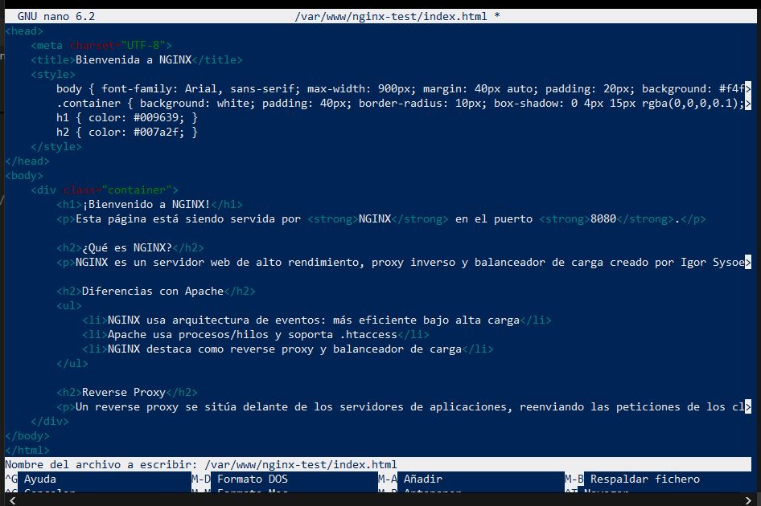

### 4.3 Cambiar el `root` al nuevo directorio

```bash
sudo nano /etc/nginx/sites-available/default
```

Buscar:

```nginx
root /var/www/html;
```

Cambiar por:

```nginx
root /var/www/nginx-test;
```

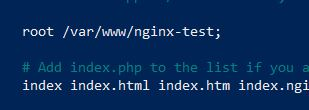

### 4.4 Comprobar la configuración y recargar

```bash
sudo nginx -t
sudo systemctl reload nginx
```

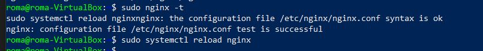

### 4.5 Verificar desde el propio servidor

```bash
curl -I http://localhost:8080
```

Debe devolver `HTTP/1.1 200 OK` y la cabecera `Server: nginx/...`.

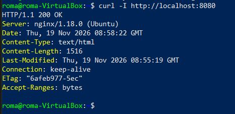

---

## 5. Comprobación desde el cliente Windows

### 5.1 Página de NGINX (puerto 8080)

```text
http://IP_DEL_SERVIDOR:8080
```

Mi página en nginx (vista desde windows)

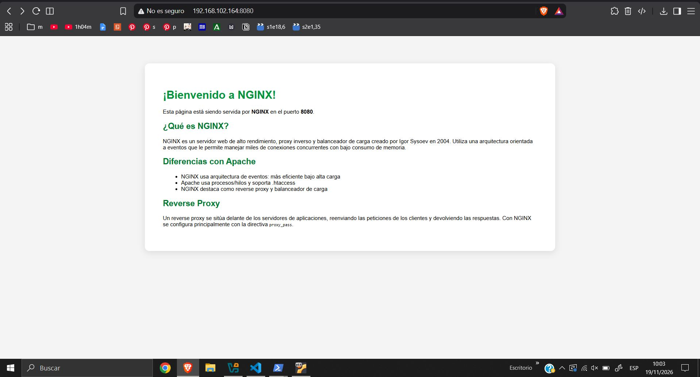

### 5.2 Página de Apache (puerto 80)

```text
http://IP_DEL_SERVIDOR
```

Mi ip es 192.168.102.164

Mi página por defecto en apache (vista desde windows):

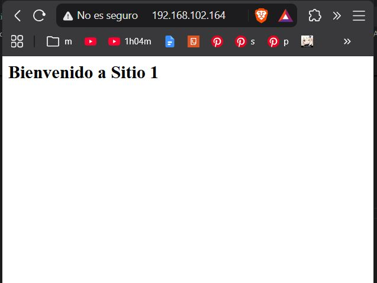

> Para conocer la IP del servidor: `ip a` o `hostname -I`.

---

## 6. Resumen de comandos

```bash
# Instalación
sudo apt update
sudo apt install nginx -y

# Comprobaciones
nginx -v
sudo ss -tlnp | grep -E ':80|:8080'
sudo nginx -t
sudo systemctl status nginx

# Configuración (puerto 8080 y root)
sudo nano /etc/nginx/sites-available/default

# Contenido
sudo mkdir -p /var/www/nginx-test
sudo nano /var/www/nginx-test/index.html

# Reinicio / recarga
sudo systemctl restart nginx
sudo systemctl reload nginx

# Prueba local
curl -I http://localhost:8080
```
