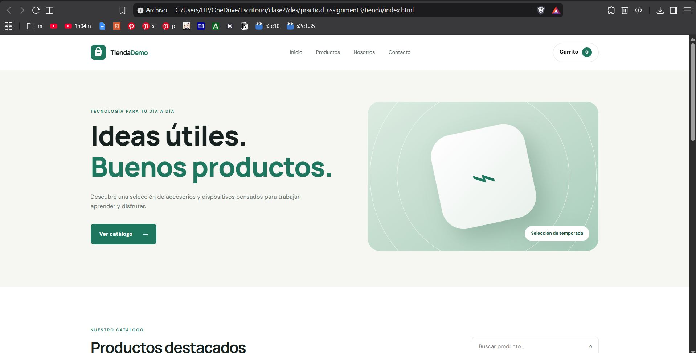
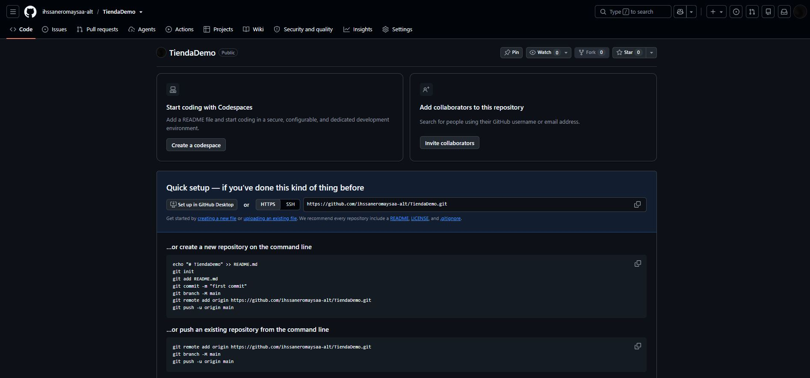
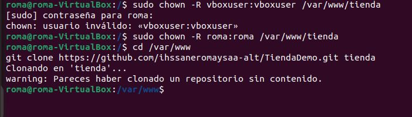
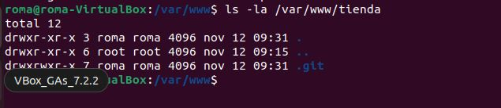
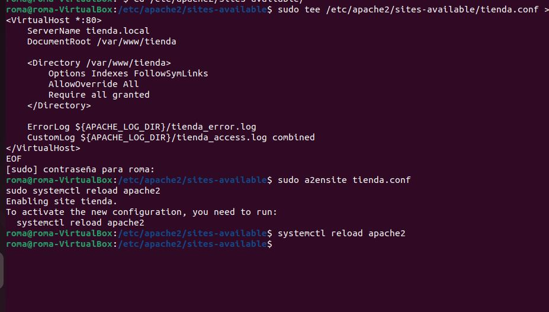
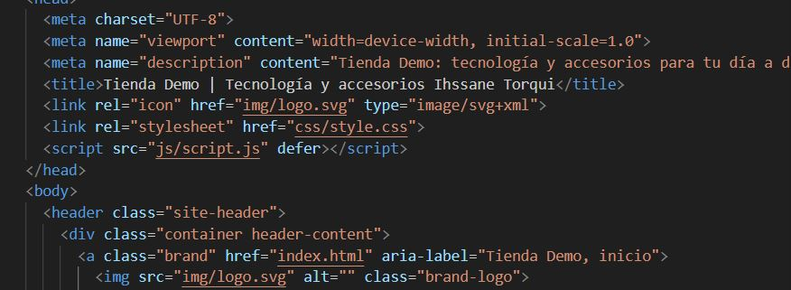
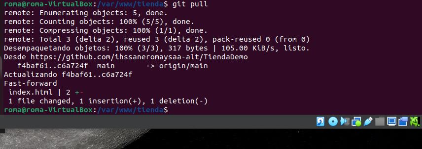
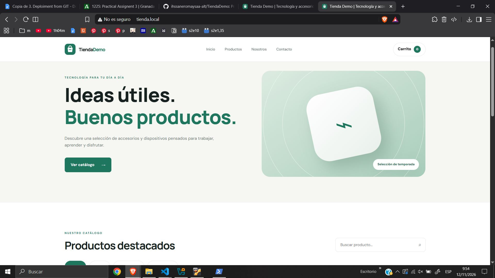

# Practice Activity: Deploying a Demo Store with Git and Apache

**Objective**  
Download the provided test website, set it up on an Ubuntu server with Git version control and Apache virtual host, make a small change from Windows, and update the production server.

**Attached file**  
`tienda-demo-practica3.zip` (dated 11 November 2026)

---

## Step-by-step instructions

### 1. Download the test web page
Download the zip file attached to this activity on Windows.

### 2. Unzip the file
Extract the contents of the zip archive.

### 3. View the example site before making changes
Open the extracted website in a browser and check that it works correctly.



### 4. Create a public GitHub repository
Go to GitHub and create a new **public** repository for this project.



### 5. Prepare the directory on Ubuntu
From Ubuntu:
- Initialise Git if needed.
- Create a directory for the store under `/var/www`.

```bash
sudo mkdir -p /var/www/tienda
```

### 6. Change ownership of the directory
Give ownership of the directory to the user `vboxuser`:

```bash
sudo chown -R vboxuser:vboxuser /var/www/tienda
```

### 7. Clone the repository on the server
Clone the GitHub repository into the server directory:

```bash
cd /var/www
git clone <your-repo-url> tienda
```



### 8. Verify the website location
Confirm that the site files are located in `/var/www/tienda`.

```bash
ls -la /var/www/tienda
```



### 9. Check permissions
Ensure correct permissions:
- Directories: `755`
- Files: `644`

```bash
find /var/www/tienda -type d -exec chmod 755 {} \;
find /var/www/tienda -type f -exec chmod 644 {} \;
```

### 10. Configure Apache virtual host
Create a new virtual host called `tienda` (following the same method used in the previous practice).

Example configuration (`/etc/apache2/sites-available/tienda.conf`):

```apache
<VirtualHost *:80>
    ServerName tienda.local
    DocumentRoot /var/www/tienda

    <Directory /var/www/tienda>
        Options Indexes FollowSymLinks
        AllowOverride All
        Require all granted
    </Directory>

    ErrorLog ${APACHE_LOG_DIR}/tienda_error.log
    CustomLog ${APACHE_LOG_DIR}/tienda_access.log combined
</VirtualHost>
```

Enable the site and reload Apache:

```bash
sudo a2ensite tienda.conf
sudo systemctl reload apache2
```



### 11. Modify the store title from Windows
On Windows, edit the title of the store so that it includes the initials of your name.  
Example:  
**“Tienda Demo: tecnología y accesorios para tu día a día. Ejemplo de iniciales”**



### 12. Version control – Commit the changes
Commit the modifications:

```bash
git add .
git commit -m "Update store title with student initials"
```

### 13. Push changes to the remote repository
Upload the changes to GitHub:

```bash
git push origin main
```

*(Use the correct branch name if it is not `main`.)*

### 14. Update the production server (Ubuntu)
On Ubuntu, pull the latest changes:

```bash
cd /var/www/tienda
git pull
```



### 15. Verification
From Windows, open the browser and go to:

```
http://tienda.local
```

Confirm that the title change is visible.



---

## Required deliverable (PDF)

Create a PDF document that contains the following information:

1. Description of the deployment performed.
2. URL of the GitHub repository used.
3. Screenshot of the `git clone` process.
4. Screenshot of the website directory structure on Ubuntu.
5. Configuration of the Virtual Host used.
6. Screenshot of the website working in the Windows browser.
7. Evidence of an update performed with `git pull`.
8. Explanation of any issues encountered and how they were solved.
